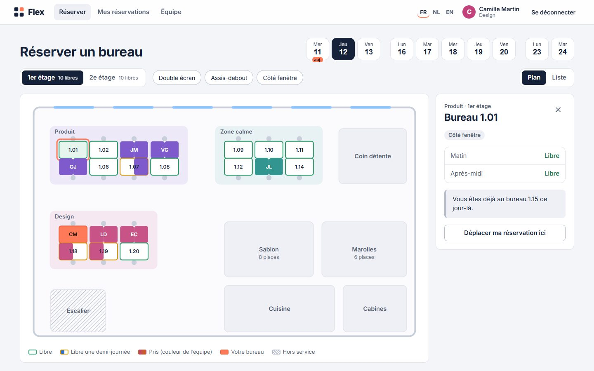
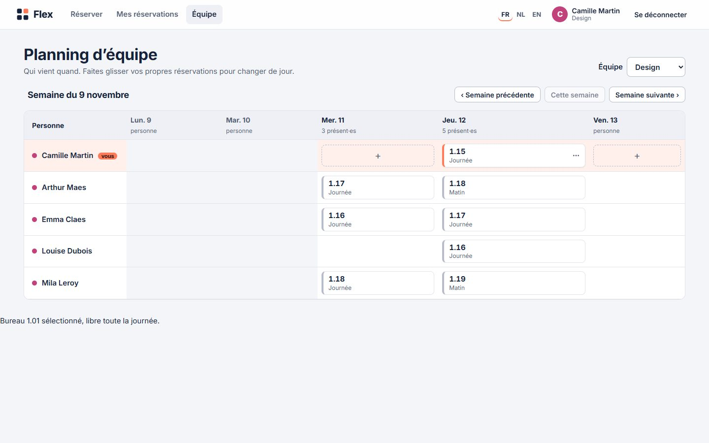
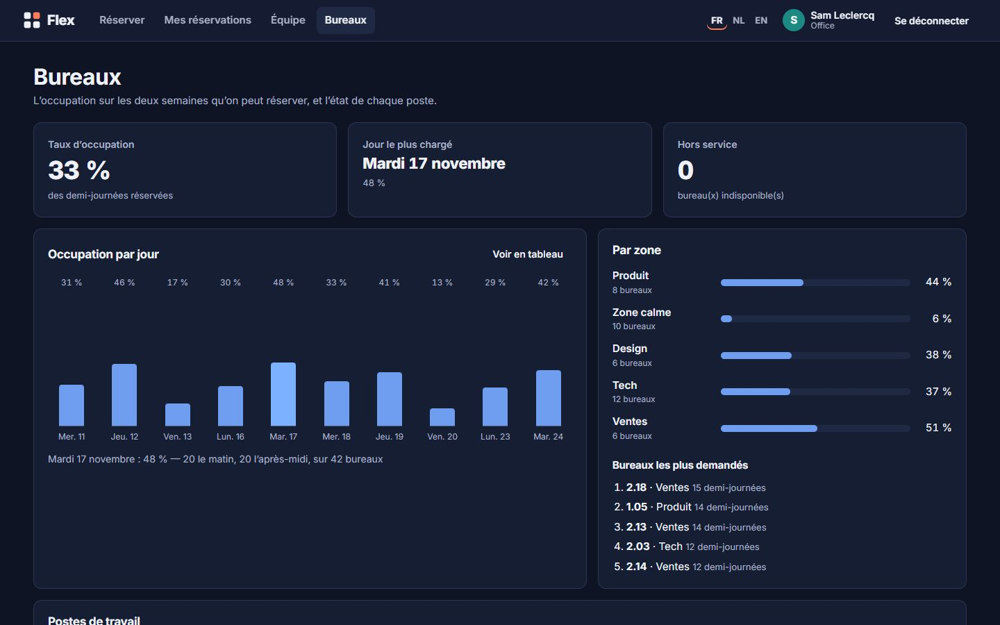
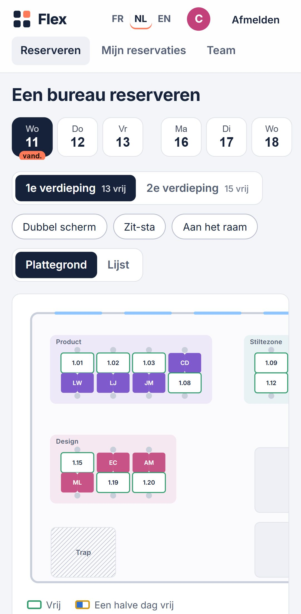

# Flex

Réservation de postes de travail pour un bureau partagé : un plan interactif en SVG, des mises à jour en direct entre collègues, un planning d’équipe en glisser-déposer, et un tableau de bord pour l’office manager. Front en Angular 22, API en NestJS 12, en français, en néerlandais et en anglais.

[](https://github.com/DonkeyhTv/flex/actions/workflows/ci.yml)

**Démo en ligne : https://flex.steve-amissi.be** — deux comptes de démo en un clic sur la page de connexion. Lumen, l’agence bruxelloise qui l’utilise, et ses 29 employés sont fictifs ; la démo est remise à zéro chaque nuit.



| Planning d’équipe | Office manager | Sur mobile |
| --- | --- | --- |
|  |  |  |

## À essayer

1. Connectez-vous comme **Camille Martin** et choisissez un jour : le plan montre qui est assis où, aux couleurs de chaque équipe.
2. Réservez un bureau libre, pour la journée ou une demi-journée.
3. Ouvrez la démo dans une deuxième fenêtre, connectez-vous comme **Sam Leclercq** et réservez un bureau : il change de couleur dans la première fenêtre, sans recharger.
4. Sur **Équipe**, faites glisser votre réservation vers un autre jour.
5. Au clavier : une tabulation entre dans le plan, les flèches passent au bureau voisin, Entrée le sélectionne.
6. Changez de langue en haut à droite : FR, NL, EN.

## Ce que le projet montre

| Sujet | Où le voir |
| --- | --- |
| Angular récent | Composants standalone, signals, `input()` / `output()`, nouveau control flow (`@if`, `@for`, `@let`), sans zone.js, `httpResource`, chargement des pages à la demande |
| Gestion d’état | [`booking.store.ts`](web/src/app/booking/booking.store.ts) : un SignalStore NgRx pour la page de réservation, avec la logique des bureaux dans des [fonctions pures testées](web/src/app/booking/desk-state.ts) |
| SVG interactif | [`floor-plan`](web/src/app/booking/floor-plan.ts) : plan dessiné à partir des données de l’API, zones calculées, demi-journées en deux couleurs |
| Accessibilité | Bureaux exposés comme boutons avec un nom complet, un seul arrêt de tabulation et navigation aux flèches, vue liste équivalente, annonces pour lecteur d’écran, menu clavier en alternative au glisser-déposer. WCAG 2.2 AA vérifié par axe-core, en thème clair et sombre |
| Temps réel | Server-sent events : [l’API diffuse](api/src/events/events.controller.ts) chaque changement, [une seule connexion par onglet](web/src/app/core/office-events.ts) partagée par les pages |
| Internationalisation | i18n natif d’Angular : un build par langue, servi sous `/fr/`, `/nl/`, `/en/`, langue du navigateur à la première visite. Une traduction manquante fait échouer le build |
| Angular CDK | Glisser-déposer, menus accessibles, `LiveAnnouncer` |
| API NestJS | Validation par schémas Zod, sessions par cookie avec `@nestjs/authentication`, protection CSRF, limitation des tentatives de connexion, documentation OpenAPI sur `/api/docs` |
| Données | Drizzle ORM et PostgreSQL 18. Les conflits de réservation sont tranchés par des index uniques partiels : deux clics simultanés sur le même bureau, un seul gagne, et un test le vérifie |

## Choix techniques

- **La base de données décide des conflits.** Une réservation porte deux booléens, matin et après-midi. Quatre index uniques partiels interdisent un bureau pris deux fois sur la même demi-journée, et une personne à deux endroits à la fois. Aucune lecture suivie d’une écriture : la course entre deux requêtes ne peut pas tourner mal. Voir [`schema.ts`](api/src/database/schema.ts).
- **Les erreurs ont un code, pas une phrase.** L’API répond `desk_taken`, `already_booked`, `weekend`… et le front affiche son propre message, dans la langue de la page. Voir [`labels.ts`](web/src/app/core/labels.ts).
- **Les jours sont des jours bruxellois.** Une réservation porte une date `AAAA-MM-JJ` dans le fuseau du bureau, jamais un instant : à 0 h 30 à Bruxelles, on est déjà le lendemain, quel que soit le fuseau du serveur.
- **Le plan est un seul arrêt de tabulation.** Avec 42 bureaux, 42 tabulations rendraient la page inutilisable au clavier. Les flèches cherchent le bureau voisin dans la direction demandée, comme sur un vrai plan. Voir `nearest()` dans [`floor-plan.ts`](web/src/app/booking/floor-plan.ts).
- **Le temps réel reste simple.** Les events ne transportent que les jours modifiés ; chaque page recharge ce qu’elle affiche si elle est concernée. Pas d’état dupliqué à réconcilier.
- **Une seule origine.** Le nginx du front sert les trois langues et relaie l’API : pas de CORS, un cookie `__Host-` en `HttpOnly`, et une CSP stricte où seuls les scripts du site s’exécutent.
- **La démo se répare toute seule.** Chaque nuit, une tâche planifiée remet les bureaux en service et régénère deux semaines de réservations crédibles : plus de monde le mardi et le jeudi, chacun près de son équipe.

## Stack

| Couche | Choix |
| --- | --- |
| Front | Angular 22, TypeScript 6, NgRx Signals, Angular CDK, SCSS |
| API | NestJS 12, Zod, Drizzle ORM, PostgreSQL 18 |
| Serveur | nginx (front et proxy), Node 24, Docker |
| Qualité | Vitest (API et front), PGlite pour les tests de l’API, Playwright et axe-core, ESLint (angular-eslint, règles d’accessibilité des templates), oxlint, Prettier, Lighthouse CI |

## Lancer le projet

Il faut Node 24.15 ou plus récent, et Docker pour PostgreSQL.

```sh
git clone https://github.com/DonkeyhTv/flex.git
cd flex
docker compose up -d                       # PostgreSQL sur le port 5434

cd api && cp .env.example .env && npm install
npm run build && node --env-file=.env dist/main.js   # http://localhost:3000/api/docs

cd ../web && npm install && npm start      # http://localhost:4200
```

Au premier démarrage, l’API applique les migrations et crée le bureau, ses employés et deux semaines de réservations.

## Tests et qualité

```sh
cd api
npm test              # règles du calendrier
npm run test:e2e      # l'application entière sur PGlite : sessions, conflits, droits, courses
npm run lint && npm run format:check

cd ../web
npx ng test --watch=false   # états des bureaux, navigation au clavier, dates
npm run lint && npm run format:check
```

Les tests navigateur tournent contre les images de production, comme dans la CI :

```sh
cd deploy && cp .env.example .env    # puis choisir DATABASE_PASSWORD, et SIGN_IN_LIMIT=1000 pour les tests
docker compose up -d --build --wait
cd ../e2e && npm install && npx playwright test
```

GitHub Actions vérifie le style, le lint et les tests de l’API et du front, construit les trois langues, puis démarre les images de production et y lance les tests navigateur (ordinateur et mobile, accessibilité comprise) et Lighthouse.

## Déploiement

[`deploy/compose.yaml`](deploy/compose.yaml) lance PostgreSQL, l’API et le nginx du front, qui écoute seulement en local. Le nginx du serveur, qui gère déjà le HTTPS d’autres sites, lui transmet les requêtes : voir [`nginx-host.conf.example`](deploy/nginx-host.conf.example).
